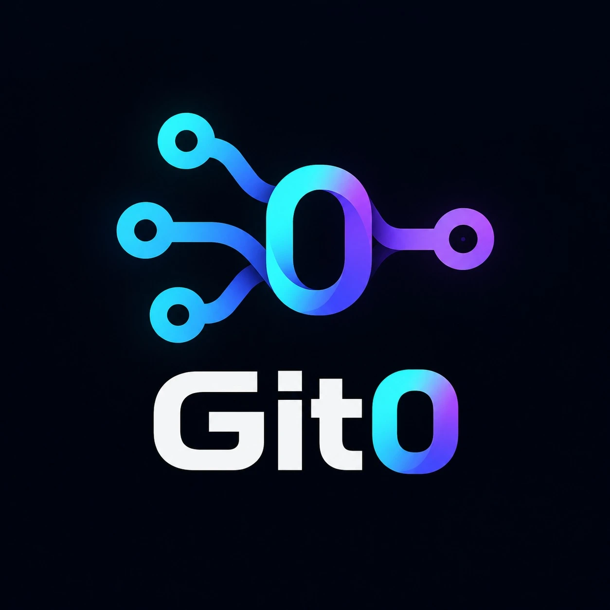
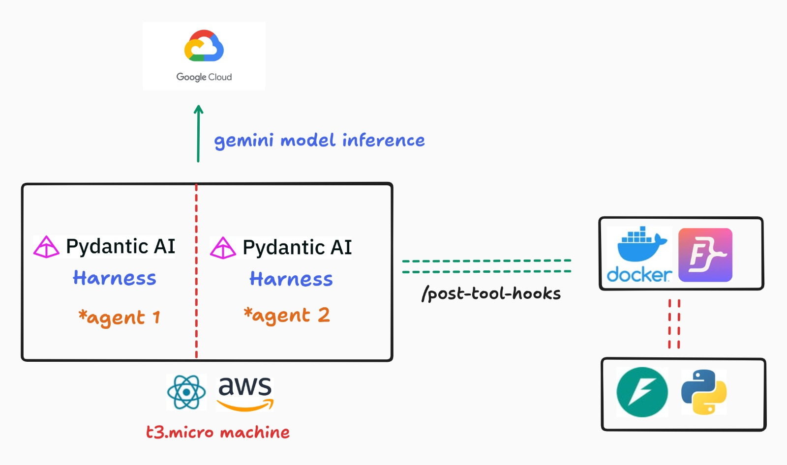
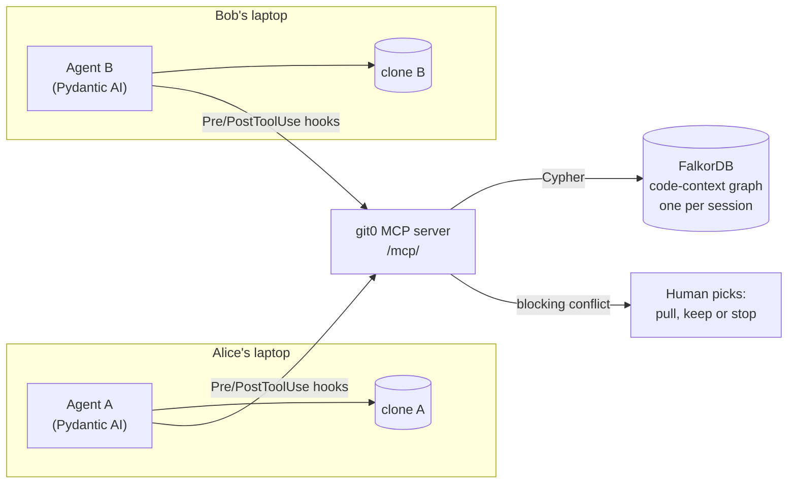
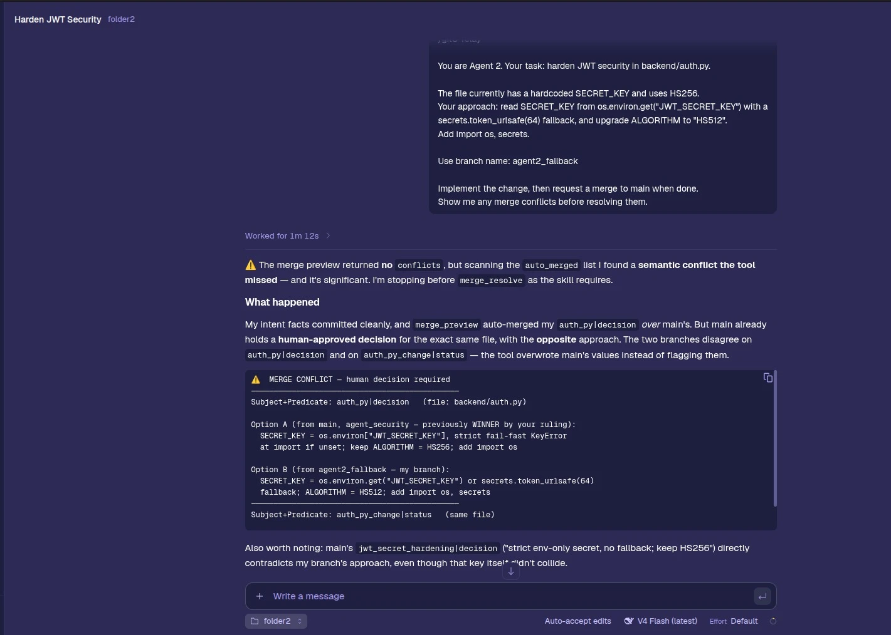

<div align="center">



# Git0 Relay

**Catch merge conflicts before they happen.<br/>Two AI coding agents, two clones, and one FalkorDB graph that stops a colliding write before it is made.**

[](https://15-252-11-70.sslip.io/ide/)
[](https://15-252-11-70.sslip.io/docs)
[](https://github.com/HXMAN76/git0/actions/workflows/ci.yml)
[](https://www.falkordb.com)
[](LICENSE)

**WeMakeDevs × FalkorDB Graph Hacks** · Track 02 **Agent Memory and Coordination** (main) · also Track 03 **Company Brain**

</div>

| Read this if you have... | |
|-|-|
| 60 seconds | [Pipeline](#pipeline-what-runs-where) → [Try it in 60 seconds](#try-it-in-60-seconds) |
| 3 minutes | [The problem](#the-problem) → [How it works](#how-it-works) → [Without FalkorDB](#what-happens-without-falkordb) → [Why not SQLite?](#why-not-just-use-sqlite) |
| 10 minutes | [Graph data model](#graph-data-model) → [Key Cypher queries](#key-cypher-queries) → [Measured and tested](#measured-and-tested) → [Quickstart](#quickstart-3-commands) |

## Pipeline: what runs where



1. **Browser (React).** The IDE at `/ide/` is a VS Code-like view built with Monaco: both clones side by side, two agent chats, the Relay log and the graph panel. FastAPI serves it as a static build on the AWS EC2 host, behind Caddy (auto-HTTPS on `sslip.io`).
2. **Agents.** Two **Pydantic AI** harness agents (A is Alice, B is Bob), each with only four tools: `list_files`, `read_file`, `write_file` and `team_context`. Each one works only inside its own clone.
3. **Model inference.** The agents call **Gemini** on Google Cloud. Each agent has its own primary model and a fallback chain, which spreads the load across free-tier rate limits.
4. **Tool hooks → MCP → FalkorDB.** Every tool call goes through Pre/PostToolUse hooks. The hooks call the git0 MCP server, mounted at `/mcp/` in the same FastAPI process, which runs the `code_*` Cypher against **FalkorDB in Docker** on the same host. FalkorDB's port is never public.
5. **FastAPI (Python)** runs the sessions: at most 8 live at once, each with its own graph and clones. A session is deleted on "End session", on tab close, after 15 minutes idle, and on restart.
6. **Deploy.** A push to `main` runs CI (ruff, Cypher-docs drift check, pytest against a real FalkorDB, web tests and build). When CI is green, GitHub Actions builds the image, pushes it to ECR and redeploys the EC2 host over SSM.


## Try it in 60 seconds
Open **https://15-252-11-70.sslip.io/ide/**. You get your own session: a private FalkorDB graph (`ide_<session>`) and two fresh clones of a tiny Python shop (`demo_project/`), one on "Alice's laptop" and one on "Bob's laptop".

1. **Click "Run the scenario".** Alice's agent adds regional tax: `apply_tax(amount)` becomes `apply_tax(amount, region)`, and `calculate_total` passes the region through. Bob's agent adds free shipping to the same `calculate_total`.
2. **Watch Bob's write get stopped.** Before every write, a hook asks the git0 MCP server: "does this collide with anything a teammate changed that I haven't seen?" FalkorDB says yes, because Alice already changed `shop/cart.py::calculate_total`. The write is denied before it reaches Bob's file.
3. **You decide.** The card offers three choices:
   - **Pull Alice's change and rework mine on top.** Alice's files are copied into Bob's clone, and Bob's agent redoes its edit.
   - **Keep my version anyway.** The write goes through, and the conflict stays visible in the graph.
   - **Stop.** Nothing is written.
4. **Look at the graph panel.** The collision path is lit: Bob's edit, the function, and Alice's `Change`. The Relay log at the bottom shows every hook call and MCP query, with timings.
5. **Click "Merge check".** It shows what plain `git merge-file` says next to what Git0 knows. Two agents editing different lines of one function merge "clean" in git and still break the logic. Git0 names the problem.

Try the **"B: Gift cards"** preset too. Bob's new code calls `apply_tax(...)` the old way after Alice changed its signature. That is a *dependency* conflict, which git can't see at all.

## The problem
Two developers clone the same repo, and each lets an AI agent write code. Agents work fast and never talk to each other. With git, the developers find out they collided days later, at merge time, and even then git only catches *textual* overlaps:
- Alice changes `apply_tax(amount)` to `apply_tax(amount, region)`. Bob writes new code that calls `apply_tax(amount)`. They're in different files, so git sees no conflict, and the build breaks.
- Both rewrite `calculate_total`, but on different lines. Git merges it "clean", and the function now mixes two pieces of logic.

The fix is to share **what each agent changed, at the level of functions and calls**, while they work, and to check every write against it.

## How it works



Every tool call an agent makes passes through hooks ([`ide/hooks.py`](src/git0/ide/hooks.py)), which call the git0 MCP server ([`mcp/server.py`](src/git0/mcp/server.py)). The server keeps one **code-context graph** in FalkorDB ([`code/relay.py`](src/git0/code/relay.py)):

- **After a write (PostToolUse)**, `code_record_edit` parses the file with Python's `ast` ([`code/parse.py`](src/git0/code/parse.py)). One Cypher query upserts the symbols, rebuilds that file's `CALLS` edges and adds a `Change` for each touched function, marked `added`, `modified`, `signature` or `removed`.
- **Before a write (PreToolUse)**, `code_check_edit` diffs the old and new source and asks the graph about teammate changes this agent hasn't acknowledged yet:

  | Conflict | Means | Severity |
  |-|-|-|
  | `same_symbol` | a teammate changed the same function | block |
  | `dependency` | my new code calls a function whose signature a teammate changed or removed | block |
  | `reverse_dependency` | I'm changing a function that a teammate's new code reaches through `CALLS*1..3` | block |
  | `intent` | a teammate announced they're about to work on this function | warn |

  A blocking hit **denies the write**. The conflict is written to the graph as a `Conflict` node (`resolution: 'pending'`), the human picks, and the choice is stored on that node.
- **Before a read**, `code_peer_activity` gives the agent heads-ups about teammate changes, so it codes against the latest picture.
- **Each user prompt** is announced as an `Intent` that targets the functions it names.
- **Deterministic authority.** Python diffs the parsed code, Cypher finds the clashing changes, and the human decides. The LLM only writes code. It never decides whether a write is safe.
- **Fail loudly.** If the relay can't be reached, the write is **denied** with the error shown ("the git0 relay could not check this write"). An unchecked write never goes through.

Any MCP harness (Command Code, Claude Code, Cursor, Gemini CLI) can use the same `code_*` tools at `/mcp/`. See [mcp.md](mcp.md).

## What happens without FalkorDB
**Git0 Relay stops. There is no other store.**

We tested it by starting the API pointed at a port with no FalkorDB behind it. Every API route we tried returned **500** (`redis.exceptions.ConnectionError: Connection refused`). Without the graph:
- **No session.** Starting a session seeds the project's symbols into a new graph (`code_seed`), so it fails.
- **No writes at all.** Every write must pass `code_check_edit`, which is four graph queries. When the relay can't answer, the hook denies the write rather than let an unchecked one through.
- **No record, no heads-ups, no path, no stored decisions.** `code_record_edit`, the peer notices, the lit collision path and the `Conflict` resolutions all live in the graph.
- **No isolation.** Each visitor's private graph `ide_<session>` is created and deleted in FalkorDB.

| Feature | Runs as | Without FalkorDB |
|-|-|-|
| Record a write | [`code_record_edit`](cypher/code_record_edit.cypher), one query | teammates never see the change |
| Block a colliding write | [`code_conflicts_same_symbol`](cypher/code_conflicts_same_symbol.cypher), [`_dependency`](cypher/code_conflicts_dependency.cypher), [`_reverse`](cypher/code_conflicts_reverse.cypher), [`_intent`](cypher/code_conflicts_intent.cypher) | no check, so every write is denied |
| "I've seen it" | [`code_acknowledge`](cypher/code_acknowledge.cypher) (`ACKED` edges) | no way to tell old news from new |
| Human decision | [`code_record_conflicts`](cypher/code_record_conflicts.cypher), [`code_resolve_conflicts`](cypher/code_resolve_conflicts.cypher) | no record of who chose what |
| Graph panel | [`code_view_nodes`](cypher/code_view_nodes.cypher), [`code_view_links`](cypher/code_view_links.cypher) | nothing to show |

## Why not just use SQLite?
To be fair: SQLite could store these rows, and it has transactions. Here is what the same product would cost there.

| Need | FalkorDB (what we run) | SQLite equivalent |
|-|-|-|
| "Does my change break code Bob wrote?" | `(caller)-[:CALLS*1..3]->(target)`, and `nodes(p)` returns the path the UI lights up | a recursive CTE over a `calls` table that builds the path as a string, then parses it back out |
| "Which of Alice's changes haven't I seen?" | `[(me:Agent)-[:ACKED]->(peer) \| me.id]` inside the same match | an anti-join against an `acks` table, written into each of the four checks |
| Two laptops, one shared truth | a network server: both agents' hooks and any MCP client talk to one graph | a file with one writer at a time on one host; remote hooks would need a server in front of it anyway |
| One graph per visitor | `ide_<session>`, dropped with `GRAPH.DELETE` | a file per visitor plus your own cleanup and routing |
| New kinds of things (`Intent`, `Conflict`) | new labels and edges, no migration | a new table and a migration each time |
| Show it | the FalkorDB Browser and our graph panel render the graph as stored | build nodes and links yourself |

Git0's core questions are path questions: what calls this, who touched it, what reaches it. In a graph database each one is a single Cypher pattern. In SQL each becomes a recursive CTE.

## Track 02 focus items → Git0 Relay
| Track 02 focus item | Where it lives |
|-|-|
| Shared state and handoffs between agents | one code-context graph that both agents read and write through MCP; "pull and rework" hands one agent's work to the other and records `ACKED` edges |
| Semantic memory | `(:File)-[:DEFINES]->(:Symbol)-[:CALLS]->(:Symbol)`: what the team's code is, function by function |
| Episodic memory | every `(:Change)` (who, when, which function, old → new signature) and every `(:Intent)` (the task each prompt started) |
| Procedural memory | each `(:Conflict)` keeps the human's resolution (`adopt`, `override`, `pause`), so the graph shows how collisions were handled |
| High-concurrency reads and writes | both agents write at the same time; every write is one atomic Cypher query (FalkorDB has no multi-query transactions) |
| Separate memory per user or tenant | one graph `ide_<session>` plus private clones per visitor, deleted when the session ends |

**Track 03 fit:** every line of code traces back to the agent and task that changed it (`Change`, `Intent`). "Who owns what" is answered by `MADE` and `TOUCHED`, and the graph stays current on every write.

## Graph data model
One graph per IDE session (`ide_<session>`), exactly as the `code_*` queries write it:
```
(:Agent {id: 'A'|'B', label})
(:File {path})-[:DEFINES]->(:Symbol {id: "<path>::<qualname>", name, path, kind, signature, body_hash,
                                     line, end_line, removed})
(:Symbol)-[:CALLS]->(:Symbol)                // rebuilt for a file on every recorded write
(:Agent)-[:MADE]->(:Change {id, agent, ts, path, symbol, kind: added|modified|signature|removed,
                            summary, old_signature, new_signature})-[:TOUCHED]->(:Symbol)
(:Agent)-[:INTENDS]->(:Intent {id, agent, task, ts, active})-[:TARGETS]->(:Symbol)
(:Agent)-[:ACKED]->(:Change)                 // "I have seen / absorbed this change"
(:Agent)-[:RAISED]->(:Conflict {id, agent, peer, kind, message, ts,
                                resolution: pending|adopt|override|pause})-[:ON]->(:Symbol)
(:Conflict)-[:AGAINST]->(:Change)
```
A removed function stays as a node with `removed = true`, so a `Change` always has a `TOUCHED` target that later checks can find.
`body_hash` is a SHA-1 of the function's `ast.dump`, so a comment-only edit doesn't count as a change. The full spec is in [docs/plans/2026-10-18-ide-demo.md](docs/plans/2026-10-18-ide-demo.md).

## Key Cypher queries
Every query lives in [`cypher/`](cypher/), one file each, with a comment saying why it exists. [docs/CYPHER.md](docs/CYPHER.md) lists them all (generated; CI checks it is current).

**same_symbol** ([`code_conflicts_same_symbol.cypher`](cypher/code_conflicts_same_symbol.cypher)): a teammate's change I haven't acknowledged touches a function my edit touches. FalkorDB has no `EXISTS {}`, so "have I seen it?" is a pattern comprehension.
```cypher
MATCH (ag:Agent)-[:MADE]->(peer:Change)-[:TOUCHED]->(s:Symbol)
WHERE s.id IN $touched AND ag.id <> $agent
WITH ag, peer, s, [(me:Agent)-[:ACKED]->(peer) | me.id] AS ackers
WHERE NOT $agent IN ackers
RETURN ag.id AS peer, ag.label AS peer_label, peer.id AS change_id, peer.summary AS summary,
       peer.kind AS change_kind, s.id AS symbol
```

**dependency** ([`code_conflicts_dependency.cypher`](cypher/code_conflicts_dependency.cypher)): my new code calls a function whose contract (signature, or the function itself) a teammate changed.
```cypher
UNWIND $edges AS e
MATCH (s:Symbol)
WHERE s.id = e.dst
MATCH (ag:Agent)-[:MADE]->(peer:Change)-[:TOUCHED]->(s)
WHERE peer.kind IN ['signature', 'removed'] AND ag.id <> $agent
WITH e, ag, peer, s, [(me:Agent)-[:ACKED]->(peer) | me.id] AS ackers
WHERE NOT $agent IN ackers
RETURN e.src AS src, s.id AS dst, ag.id AS peer, ag.label AS peer_label, peer.id AS change_id,
       peer.summary AS summary
```

**reverse_dependency** ([`code_conflicts_reverse.cypher`](cypher/code_conflicts_reverse.cypher)): I'm changing the contract of a function that a teammate's new code reaches through up to three calls. The path comes back so the UI can light it up.
```cypher
UNWIND $contract AS cid
MATCH (target:Symbol)
WHERE target.id = cid
MATCH p = (caller:Symbol)-[:CALLS*1..3]->(target)
MATCH (ag:Agent)-[:MADE]->(peer:Change)-[:TOUCHED]->(caller)
WHERE ag.id <> $agent
WITH target, caller, ag, peer, [n IN nodes(p) | n.id] AS path,
     [(me:Agent)-[:ACKED]->(peer) | me.id] AS ackers
WHERE NOT $agent IN ackers
RETURN target.id AS symbol, caller.id AS caller, ag.id AS peer, ag.label AS peer_label,
       peer.id AS change_id, peer.summary AS summary, path
```

**record_edit**: the symbols, removed symbols, `CALLS` edges and one `Change` per touched function, written as one all-or-nothing query (see [`code_record_edit.cypher`](cypher/code_record_edit.cypher)).

## Measured and tested
- **Tested against a real FalkorDB in CI:** 250 tests pass (`make test`), including the parser (28), relay graph operations (15), merge check (8), hooks, harness, sessions, sandboxing and rate limiting. Tests never mock the graph; each one gets a throwaway graph.
- **Without FalkorDB, every API route we tried returns 500** (tested as described [above](#what-happens-without-falkordb)).
- **Live timings:** the Relay log in the IDE shows how long every hook call and MCP query took, as it happens. We don't publish benchmark numbers we haven't measured.
- **Works outside our IDE.** Below, the Command Code harness runs on the **DeepSeek V4 Flash** model and connects to the git0 MCP server. The agent (Agent 2, task "harden JWT security") previewed a merge into main. It saw that its `auth_py|decision` would replace main's human-approved decision with the opposite approach, stopped before `merge_resolve`, and asked the human to choose. The preview had reported no conflicts, but its `auto_merged` list carried the clash, and the agent flagged it.



## Tech stack
| Layer | What |
|-|-|
| Graph | FalkorDB v4.22.1, one graph per IDE session |
| Agents | **Pydantic AI** + Gemini, with a per-agent model fallback chain |
| Coordination | MCP server (streamable HTTP at `/mcp/`), Pre/PostToolUse hooks, Python `ast` parser, `git merge-file` for the merge check |
| Backend | Python 3.12, FastAPI, `falkordb` async client, Pydantic v2 |
| Frontend | React 19, Vite, Tailwind v4, Monaco editor, graph panel |
| Infra | Docker on AWS EC2 (ap-south-1) behind Caddy; GitHub Actions → ECR → SSM deploy after green CI |

## Quickstart (3 commands)
Needs `uv`, `pnpm`, and Docker or Podman.
```bash
make setup
```
```bash
make db-up
```
```bash
make test
```
`make setup` installs the Python and web deps (`uv sync`, `pnpm install`). `make db-up` starts FalkorDB v4.22.1 on `:6379` (browser UI on `:3000`); stop any other FalkorDB or Redis on those ports first. `make test` runs the 250 tests against the real graph.

To run the IDE: `cp .env.example .env`, add a `GEMINI_API_KEY`, then run `make api` (port 8000) and `make web`, and open **http://localhost:5173/ide/**.

## Repo map
| Path | What |
|-|-|
| [`src/git0/code/`](src/git0/code/) | `parse.py` (Python source to symbols and calls), `relay.py` (`CodeRelay`, every graph operation) |
| [`cypher/`](cypher/) (`code_*.cypher`) | every relay query, one file each |
| [`src/git0/ide/`](src/git0/ide/) | sessions and sweeper, Pydantic AI coding agents (`harness.py`), hooks, merge check, `/api/ide` routes |
| [`src/git0/mcp/`](src/git0/mcp/) | MCP server: the `code_*` tools used by the hooks and by any external harness |
| [`demo_project/`](demo_project/) | the small Python shop every visitor gets a fresh copy of |
| [`web/src/ide/`](web/src/ide/) | the IDE UI (`/ide/`) |
| [`tests/`](tests/) | pytest against a real FalkorDB (throwaway graph per test) |
| [`docs/`](docs/) | [all Cypher](docs/CYPHER.md), [IDE spec](docs/plans/2026-10-18-ide-demo.md), [architecture](docs/ARCHITECTURE.md), [ADRs](docs/adr/) |

The repo also holds our earlier prototype, memory branches for chat agents (`src/git0/core/`, `src/git0/agents/`), described in [docs/ARCHITECTURE.md](docs/ARCHITECTURE.md). The relay follows the same rules: one query per write, every query in `cypher/`, deterministic decisions.

## Team
| Name | Role |
|-|-|
| Hari Heman V K ([@HXMAN76](https://github.com/HXMAN76)) | Graph core: Cypher and graph model |
| Roshan T ([@Git-Roshan09](https://github.com/Git-Roshan09)) | Agents, LLM, MCP server |
| Raghav N ([@Rag-795](https://github.com/Rag-795)) | Benchmark and concurrency |
| Sai Nivedh ([@SaiNivedh26](https://github.com/SaiNivedh26)) | UI, API, deploy |

## AI assistance disclosure
We used AI coding assistants (Claude Code) for research, scaffolding, parts of the implementation, and this README. Commits with meaningful AI help carry an `Assisted-by:` trailer. Every team member reviewed and ran the code and can explain the graph model, the queries and the architecture.

## License
[MIT](LICENSE)
