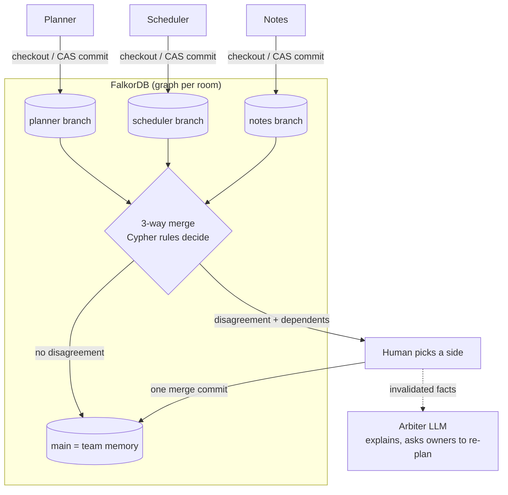

<div align="center">

# Git0

**Agents get their own memory branches. FalkorDB merges what they learned by meaning, not by text,<br/>and every answer shows the commit path it came from.**

[](https://15-252-11-70.sslip.io)
[](https://15-252-11-70.sslip.io/ide/)
[](https://15-252-11-70.sslip.io/docs)
[](https://github.com/HXMAN76/git0/actions/workflows/ci.yml)
[](https://www.falkordb.com)
[](LICENSE)

**WeMakeDevs × FalkorDB Graph Hacks** · Track 02 **Agent Memory and Coordination** (main) · also Track 03 **Company Brain**

</div>

| Read this if you have... | |
|-|-|
| 60 seconds | [Try it in 60 seconds](#try-it-in-60-seconds) |
| 3 minutes | [The problem](#the-problem) → [How it works](#how-it-works) → [Without FalkorDB](#what-happens-without-falkordb) → [Why not SQLite?](#why-not-just-use-sqlite) |
| 10 minutes | [Graph data model](#graph-data-model) → [Key Cypher queries](#key-cypher-queries) → [Pipeline](#pipeline-what-runs-where) → [Quickstart](#quickstart-3-commands) |

## Try it in 60 seconds

### Memory branches: https://15-252-11-70.sslip.io
You get your own team room, a private FalkorDB graph seeded with a launch plan: 37 facts on `main`, plus a Scheduler branch that booked the venue, sent invites and set catering, all for **Friday**.

1. **Tell Planner "The launch moved to Monday."** It's one click in the "Try the demo" bar. Planner commits `launch|deadline = monday` to *its own* branch.
2. **Click Merge Scheduler.** Its Friday bookings join team memory. No disagreement yet.
3. **Click Merge Planner.** The card says **"Planner and Scheduler disagree"**. Venue, invites and catering were built on Friday, and Planner just changed Friday. A line-based merge would call this clean, because they are different keys. The Arbiter explains the disagreement in plain words.
4. **Pick a side.** One merge commit lands. Pick Monday, and the three Friday tasks are removed and the **Arbiter asks Scheduler to re-plan only those**. Every other fact stays untouched.
5. **Click "why?" on any answer.** The fact, the commit, the agent and the chat turn light up in the memory graph. Ask about something nobody said, like the caterer's contact, and the agent replies *"Not in team memory (no path from HEAD)"* instead of guessing.

### Code relay: https://15-252-11-70.sslip.io/ide/
1. Click **Run the scenario**. Alice's agent adds regional tax (`apply_tax(amount, region)`). Bob's agent adds free shipping to the same `calculate_total`.
2. Bob's write is **stopped before it happens**. The PreToolUse hook asked FalkorDB "does this collide with anything a teammate changed?" and the answer was yes.
3. **You decide:** pull Alice's change and rework on top, keep yours, or pause. The graph panel lights up the collision path, and **Merge check** shows what plain `git merge-file` would have said versus what Git0 knows.

## The problem
Multi-agent systems share one memory, and the last write wins. Planner moves the launch to Monday, but Scheduler already booked the venue for Friday. Nothing flags it. Scheduler's tasks now rest on a value that is no longer true, and nobody finds out until the venue is empty on Monday.

Text-based "git for memory" doesn't help either. Venue and deadline are different lines, so a line merge calls it clean. The same thing happens with code: two AI agents edit different lines of the same function, git merges it cleanly, and the logic is broken.

## How it works



- **Branch per agent.** Planner, Scheduler and Notes each write facts `(subject, predicate, object)` to their own branch. Agents read memory **only** through `checkout(branch)`. There are no caches and no agent-to-agent messages, so FalkorDB is the only channel between them.
- **Every commit is one Cypher query** with compare-and-set on the branch HEAD. If HEAD moved, 0 rows come back, nothing is written, and the client retries. Concurrent agents never lose an update.
- **3-way semantic merge** ([`core/merge.py`](src/git0/core/merge.py)). Merge base vs ours vs theirs, keyed by `subject|predicate`. Per-predicate `(:Rule)` nodes decide: `deadline` and `owner` need review, `preference` is latest-wins. A one-sided change is still flagged (`reason=dependency`) when the other side **derived new facts from the value being replaced**. That's the Friday/Monday case.
- **Deterministic authority.** Cypher rules and the human decide. The Arbiter LLM only writes the explanation and re-derives the invalidated facts. If the LLM fails, the API returns 502 and the UI shows a red banner. There is never canned output.
- **Precedent.** Each resolution is saved as a `(:Precedent)`. The next conflict on the same predicate shows which side the team picked before and how many times (e.g. "target chosen 2x").
- **Code relay** ([`code/relay.py`](src/git0/code/relay.py), [`ide/`](src/git0/ide/)). The same idea applied to code. A code-context graph holds files, symbols, `CALLS` edges, each agent's `Change`s and announced `Intent`s. After a write, `code_record_edit` records which symbols changed and whether a signature changed. Before a write, `code_check_edit` checks the peer's unseen changes: the same function, a call to a function whose signature changed, or a function the peer's new code reaches through `CALLS*1..3`. A hit blocks the write. Any MCP harness (Claude Code, Cursor, Gemini CLI) can use the same tools at `/mcp/`. See [mcp.md](mcp.md).

## What happens without FalkorDB
**The application stops working. There is no other store to fall back on.**

We tested it: we started the API pointed at a port with no FalkorDB behind it.
- `/api/health`, `/seed`, `/checkout` and `/scorecard` all return **500** (`redis.exceptions.ConnectionError: Connection refused`).
- An agent turn fails before it says a word. The first thing `agents.base.step` does is `checkout(branch)`, and that is a Cypher query. Agents hold no state between turns, so with the graph gone **they know nothing**, not even their own past answers.
- The IDE hooks fail too. `code_check_edit` and `code_record_edit` are graph queries, so no collision can be detected.

Here is what each feature loses:

| Feature | Runs as | Without FalkorDB |
|-|-|-|
| Agent memory (checkout) | [`checkout.cypher`](cypher/checkout.cypher) | agents have no facts and cannot answer |
| Writing memory | one CAS query, [`commit_cas.cypher`](cypher/commit_cas.cypher) | nothing is saved; concurrent writes can't be ordered |
| Merge + dependency conflicts | [`merge_base`](cypher/merge_base.cypher), [`dependents_visible`](cypher/dependents_visible.cypher), [`merge_commit`](cypher/merge_commit.cypher) | no "Planner and Scheduler disagree" card |
| Why-path, "not in memory" | [`why_path`](cypher/why_path.cypher), [`fact_lookup`](cypher/fact_lookup.cypher) | answers can't be traced or proven absent |
| Precedent, scorecard | [`precedent_lookup`](cypher/precedent_lookup.cypher), [`scorecard`](cypher/scorecard.cypher) | no learned decisions, no live counters |
| Tenant rooms | one graph per room `team_<id>` | no isolation, no TTL sweep |
| Code relay | [`code_conflicts_*`](cypher/), [`code_record_edit`](cypher/code_record_edit.cypher) | the agents' collision goes unnoticed until git merge time |

## Why not just use SQLite?
To be fair: SQLite could store these rows, and SQLite has transactions, so a compare-and-set commit is possible there too. Here is what the same product would cost on SQLite.

| Need | FalkorDB (what we run) | SQLite equivalent |
|-|-|-|
| "What was built on Friday?" | `(d:Fact)-[:DERIVED_FROM*1..6]->(f)`, one pattern | a recursive CTE over a `derived_from` join table, with a depth counter and a cycle guard, re-joined to commit visibility |
| "Does my edit reach code Bob changed?" | `(caller)-[:CALLS*1..3]->(target)` and `nodes(p)` returns the path the UI lights up | a recursive CTE that builds the path as a string, then parses it back out |
| Why-path for an answer | one match: fact ← commit ← agent → episode | a 4-table join written per question |
| Many writers on many machines | a network server: the API, the MCP endpoint and hooks on two "laptops" all talk to one graph | a file with one writer at a time on one host; the MCP clients would need a server in front of it anyway |
| One memory per team | `GRAPH.QUERY team_<id>`, `GRAPH.DELETE`, list graphs on one server | a file per tenant plus your own cleanup and routing |
| New memory kinds (`Procedure`, `Intent`, `Change`) | new labels and edges, no migration | a new table and migration each time |
| Show the memory | the FalkorDB Browser and `@falkordb/canvas` render the graph as stored | build nodes and links yourself |

The bigger point: Git0's core questions are path questions ("what depends on this?", "what reaches this function?", "where did this answer come from?"). In a graph database they are one Cypher pattern each. In SQL they become recursive CTEs.

## Pipeline: what runs where


1. **Browser (React).** The team room (`/`) and the IDE (`/ide/`) are served as one static build by FastAPI on the AWS EC2 host, behind Caddy (auto-HTTPS on `sslip.io`).
2. **Agents.** In the IDE demo, two **Pydantic AI** harness agents (Alice and Bob) each work in their own clone. Memory-branch agents (Planner, Scheduler, Notes, Arbiter) run a plain loop: `checkout → LLM → commit`.
3. **Model inference.** The IDE agents call **Gemini** on Google Cloud. The memory agents call **Groq** `openai/gpt-oss-20b` with a strict JSON schema and fall back to Gemini. Every output is validated with Pydantic, and a failure surfaces as an error.
4. **Tool hooks → MCP → FalkorDB.** Every agent tool call passes Pre/PostToolUse hooks, which call the git0 MCP server (`/mcp/`). That server runs the `code_*` Cypher queries against **FalkorDB in Docker** on the same host. FalkorDB's port is never public.
5. **FastAPI (Python)** owns every write: one Cypher query each, loaded by name from [`cypher/`](cypher/). It also runs the room TTL sweep and the IDE session sweeper.
6. **Deploy.** A push to `main` runs CI (ruff, Cypher-docs drift check, pytest against a real FalkorDB, web tests and build). When CI is green, GitHub Actions builds the image, pushes it to ECR and redeploys the EC2 host over SSM.

## Track 02 focus items → live features
The right panel of the app shows a live scorecard, read from the graph by one query ([`scorecard.cypher`](cypher/scorecard.cypher)).

| Track 02 focus item | Git0 feature | Scorecard counter |
|-|-|-|
| Semantic memory | `(:Fact {s,p,o})`, visible per branch | Facts in team memory |
| Episodic memory | `(:Episode)` per chat turn, linked to the commit it produced | Chat turns remembered |
| Procedural memory | versioned `(:Procedure)`, plus `(:Rule)` and `(:Precedent)` reused on the next conflict | Learned procedures · Past decisions reused |
| Persistent conversation history | `(:Session)-[:HAS_TURN]->(:Episode)`; agents resume from `checkout` + `log` after a restart | Sessions |
| Shared state and handoffs | merge into `main`; `POST /api/{t}/agents/{a}/kill` hands a branch to a successor, which reads it and commits a `handoff` | Merges · Handoffs |
| High-concurrency reads/writes | one-query CAS commit + retry | Memory updates |
| Separate memory per tenant | one graph per room `team_<id>` (idle rooms swept after 2 h); one graph per IDE session `ide_<sid>` | Live team rooms |

**Track 03 fit:** every fact traces back to its agent, commit and chat turn (why-path); `owner` is a first-class predicate; merges keep knowledge current as plans change.

## Graph data model
One graph per team room (`team_<id>`). The full model with invariants is in [docs/ARCHITECTURE.md §2](docs/ARCHITECTURE.md#2-graph-model-per-tenant-graph-team_id).

```
(:Branch {name})-[:HEAD]->(:Commit {id, seq, kind, ancestors:[ids]})-[:PARENT]->(:Commit)   // 2 parents on a merge
(:Agent)-[:AUTHORED]->(:Commit)-[:FROM_EPISODE]->(:Episode)<-[:HAS_TURN]-(:Session)
(:Fact {s, p, o, key: s+'|'+p})-[:ADDED_IN | REMOVED_IN]->(:Commit)      // facts are never edited or deleted
(:Fact)-[:DERIVED_FROM]->(:Fact)                                       // "venue booked friday" <- "launch = friday"
(:Procedure {trigger, steps})-[:ADDED_IN | REMOVED_IN]->(:Commit)
(:Conflict {key, status})-[:RESOLVED_IN]->(:Commit)
(:Conflict)-[:RESOLVED_BY]->(:Precedent {key_pattern, choice, count})
(:Rule {p, strategy})                                                  // deadline: needs-review, preference: latest-wins
```

Code relay graph (one per IDE session, `ide_<sid>`):
```
(:File {path})-[:DEFINES]->(:Symbol {id, signature, body_hash})-[:CALLS]->(:Symbol)
(:Agent)-[:MADE]->(:Change {kind, old_signature, new_signature})-[:TOUCHED]->(:Symbol)
(:Agent)-[:INTENDS]->(:Intent {task, active})-[:TARGETS]->(:Symbol)
(:Agent)-[:ACKED]->(:Change)                                           // "I have seen this change"
```

## Key Cypher queries
All 39 queries live in [`cypher/`](cypher/), one file each, with a comment saying why it exists. [docs/CYPHER.md](docs/CYPHER.md) lists them all (generated; CI checks it is current).

**Checkout**: the facts visible on a branch. Each commit stores its `ancestors` once (commits are immutable), which avoids path blow-up on merge-heavy histories. FalkorDB has no `EXISTS {}`, so this uses `OPTIONAL MATCH` + `none()`.
```cypher
MATCH (:Branch {name: $branch})-[:HEAD]->(h:Commit)
WITH h.ancestors + [h.id] AS anc
MATCH (f:Fact)-[:ADDED_IN]->(c:Commit) WHERE c.id IN anc
OPTIONAL MATCH (f)-[:REMOVED_IN]->(r:Commit)
WITH f, anc, collect(r.id) AS rs
WHERE none(x IN rs WHERE x IN anc)
RETURN DISTINCT f
```

**Commit with compare-and-set** (the start of [`commit_cas.cypher`](cypher/commit_cas.cypher)). A stale `$expected` matches nothing, so nothing is written. Facts, removals, episodes and derivations follow in `CALL { WITH n UNWIND ... }` unit subqueries, all in the same query.
```cypher
MATCH (b:Branch {name: $branch})-[r:HEAD]->(h:Commit {id: $expected})
CREATE (n:Commit {id: $id, seq: h.seq + 1, kind: $kind, ancestors: h.ancestors + [h.id]})-[:PARENT]->(h)
DELETE r
CREATE (b)-[:HEAD]->(n)
```

**Merge base**: the latest common ancestor.
```cypher
MATCH (:Branch {name: $a})-[:HEAD]->(ha:Commit), (:Branch {name: $b})-[:HEAD]->(hb:Commit)
WITH ha.ancestors + [ha.id] AS aa, hb.ancestors + [hb.id] AS bb
MATCH (c:Commit) WHERE c.id IN aa AND c.id IN bb
RETURN c.id ORDER BY c.seq DESC LIMIT 1
```

**Dependents still visible at a commit**: what goes stale if a value changes. This powers dependency conflicts and the revert cascade.
```cypher
MATCH (d:Fact)-[:DERIVED_FROM*1..6]->(:Fact {id: $fid})
MATCH (h:Commit {id: $head})
WITH d, h.ancestors + [h.id] AS anc
MATCH (d)-[:ADDED_IN]->(c:Commit) WHERE c.id IN anc
OPTIONAL MATCH (d)-[:REMOVED_IN]->(r:Commit)
WITH d, anc, collect(r.id) AS rs
WHERE none(x IN rs WHERE x IN anc)
RETURN DISTINCT d
```

**Code relay, reverse dependency**: a peer's unseen change to code that calls what I am about to change.
```cypher
MATCH p = (caller:Symbol)-[:CALLS*1..3]->(target:Symbol {id: $cid})
MATCH (ag:Agent)-[:MADE]->(peer:Change)-[:TOUCHED]->(caller)
WHERE ag.id <> $agent
```

Also: [`why_path`](cypher/why_path.cypher), [`merge_commit`](cypher/merge_commit.cypher) (two-parent merge + Conflict + Precedent in one query), [`precedent_lookup`](cypher/precedent_lookup.cypher), [`fact_lookup`](cypher/fact_lookup.cypher) ("not in memory"), [`graph_view`](cypher/graph_view.cypher).

## Measured numbers
These are measured in this repo. We don't publish results we don't have.
- **20 concurrent writers on one branch: 20 commits land, linear history, 0 lost** ([`test_concurrent_writers_lose_nothing`](tests/core/test_repo.py), runs in CI against a real FalkorDB).
- **Checkout at 250 / 500 / 1000 linear commits: 17 / 40 / 103 ms. Merge base: 2 / 3 / 6 ms** (FalkorDB v4.22.1, local; [ARCHITECTURE §3](docs/ARCHITECTURE.md#3-verified-falkordb-behaviour-tested-2026-10-16-on-falkordbfalkordblatest)).
- **Without FalkorDB, every API route returns 500** (tested as described [above](#what-happens-without-falkordb)).
- The benchmark (Git0 vs last-write-wins vs text-git) is only a skeleton in [`bench/`](bench/), and there are **no results yet**, so we report none.

## Tech stack
| Layer | What |
|-|-|
| Graph | FalkorDB v4.22.1, one graph per team room / IDE session |
| Backend | Python 3.12, FastAPI, `falkordb` async client, Pydantic v2 |
| LLM | Groq `openai/gpt-oss-20b` (strict JSON schema) → Gemini fallback (memory agents + Arbiter); **Pydantic AI** + Gemini (IDE agents) |
| Agent tooling | MCP server (streamable HTTP at `/mcp/`), Pre/PostToolUse hooks, `ast`-based Python parser |
| Frontend | React 19, Vite, Tailwind v4, `@falkordb/canvas` memory graph, xyflow + dagre commit DAG, Monaco (IDE) |
| Infra | Docker on AWS EC2 (ap-south-1) behind Caddy; GitHub Actions → ECR → SSM deploy after green CI |

## Quickstart (3 commands)
Needs `uv`, `pnpm`, and Docker or Podman.
```bash
make setup
```
```bash
make db-up
```
```bash
make test
```
`make setup` installs the Python and web deps. `make db-up` starts FalkorDB on `:6379` (browser UI on `:3000`). `make test` runs the test suite against the real graph.

To run the app: `cp .env.example .env`, add a `GROQ_API_KEY` and/or `GEMINI_API_KEY`, then `make api` (http://localhost:8000/docs) and `make web` (http://localhost:5173, IDE demo at http://localhost:5173/ide/).

## Repo map
| Path | What |
|-|-|
| [`cypher/`](cypher/) | every query, one file each (single source of truth) |
| [`src/git0/core/`](src/git0/core/) | `MemoryRepo` (commit, checkout, log, merge base, why), 3-way merge, revert cascade, models |
| [`src/git0/agents/`](src/git0/agents/), [`llm/`](src/git0/llm/) | Planner / Scheduler / Notes / Arbiter, handoff, LLM client (fails loudly, no fallback text) |
| [`src/git0/code/`](src/git0/code/), [`ide/`](src/git0/ide/) | code parser + relay graph, IDE sessions, hooks, Pydantic AI coding agents, merge check |
| [`src/git0/mcp/`](src/git0/mcp/) | MCP server (memory tools + `code_*` relay tools) |
| [`src/git0/api/`](src/git0/api/) | FastAPI app, tenant rooms and TTL sweep |
| [`web/`](web/) | React app (`/`) and IDE demo (`/ide/`) |
| [`demo_project/`](demo_project/) | the small Python shop every IDE visitor gets a fresh copy of |
| [`tests/`](tests/) | pytest against a real FalkorDB (throwaway graph per test) |
| [`docs/`](docs/) | [architecture](docs/ARCHITECTURE.md), [all Cypher](docs/CYPHER.md), [stack](docs/STACK.md), [ADRs](docs/adr/), [team split](docs/team/README.md) |

## Team
| Name | Role |
|-|-|
| Hari Heman V K ([@HXMAN76](https://github.com/HXMAN76)) | Graph core: Cypher, `MemoryRepo`, merge |
| Roshan T ([@Git-Roshan09](https://github.com/Git-Roshan09)) | Agents, LLM client, MCP server |
| Raghav N ([@Rag-795](https://github.com/Rag-795)) | Benchmark and concurrency |
| Sai Nivedh ([@SaiNivedh26](https://github.com/SaiNivedh26)) | UI, API, deploy |

## AI assistance disclosure
We used AI coding assistants (Claude Code) for research, scaffolding, parts of the implementation, and this README. Commits with meaningful AI help carry an `Assisted-by:` trailer. Every team member reviewed and ran the code and can explain the graph model, the queries and the architecture.

## License
[MIT](LICENSE)
