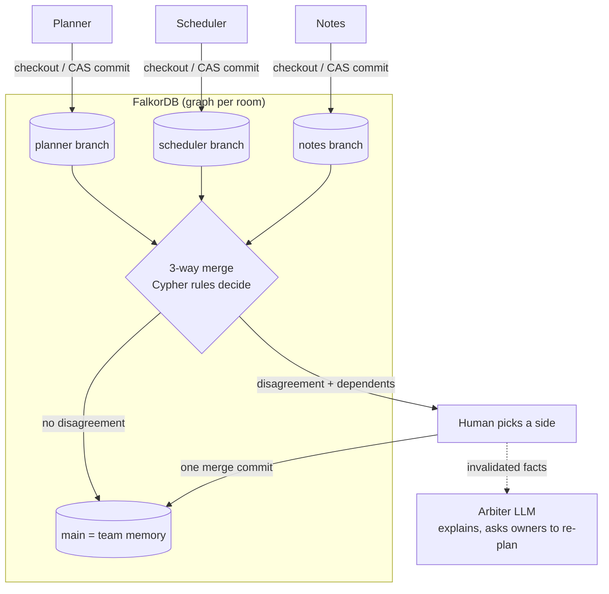

# Git0

**Agents get their own memory branches. FalkorDB merges what they learned by meaning, not by text, and every answer shows the commit path it came from.**

**Live demo: https://15-252-11-70.sslip.io** · IDE demo: https://15-252-11-70.sslip.io/ide/ · API docs: https://15-252-11-70.sslip.io/docs

Built for **WeMakeDevs × FalkorDB Graph Hacks**. Tracks entered: **Track 02 Agent Memory and Coordination** (main), also **Track 03 Company Brain**.

## Try it in 60 seconds
Open the live link. You get your own team room (a private FalkorDB graph) seeded with a launch plan: 37 facts on `main`, and a Scheduler branch that booked the venue and sent invites for **Friday**.

1. Tell **Planner**: *"The launch moved to Monday."* (one click in the "Try the demo" bar). Planner commits `launch|deadline = monday` to its own branch.
2. Click **Merge Scheduler**. Its Friday bookings join team memory. No disagreement yet.
3. Click **Merge Planner**. The card says **"Planner and Scheduler disagree"**: the venue, invites and catering were built on Friday, and Planner changed Friday. The Arbiter explains it in plain words.
4. **Pick a side.** One merge commit lands. If you pick Monday, the three Friday tasks are removed and the **Arbiter asks Scheduler to re-plan only those**. The other facts stay untouched.
5. Click **why?** on any agent answer: the fact, the commit, the agent and the chat turn light up in the memory graph. Ask about something nobody said (e.g. the caterer's contact): the agent replies *"Not in team memory (no path from HEAD)"* instead of guessing.

## The problem
Multi-agent systems share one memory, and the last write wins. Planner moves the launch to Monday. Scheduler already booked the venue for Friday. Nothing flags it: Scheduler's tasks now rest on a value that is no longer true, and no one finds out until the venue is empty on Monday.

Text-based "git for memory" doesn't fix this either. Venue and deadline are different lines, so a line merge calls it clean.

## How it works



- **Branch per agent.** Each agent (Planner, Scheduler, Notes) writes facts `(subject, predicate, object)` to its own branch. Agents read memory **only** through `checkout(branch)`. There are no caches and no agent-to-agent messages, so FalkorDB is the only channel between them.
- **Every commit is one Cypher query** with compare-and-set on the branch HEAD. If HEAD moved, 0 rows come back, nothing is written, and the client retries. Concurrent agents never lose an update.
- **3-way semantic merge** (`src/git0/core/merge.py`). Merge base vs ours vs theirs, keyed by `subject|predicate`. Per-predicate `(:Rule)` nodes decide: `deadline` and `owner` need review, `preference` is latest-wins. A one-sided change is still flagged (`reason=dependency`) when the other side **derived new facts from the value being replaced**. That is the Friday/Monday case, and a line merge cannot see it.
- **Deterministic authority.** Cypher rules plus the human decide. The Arbiter LLM only writes the explanation and re-derives the invalidated facts. If the LLM fails, the API returns a 502 and the UI shows a red banner. There is no canned output.
- **Precedent.** Each resolution is saved as a `(:Precedent)`. The next conflict on the same predicate shows which side the team picked before and how many times (e.g. "target chosen 2x").

### Git0 Relay: the same idea for code (IDE demo, `/ide/`)
Two AI coding agents ("Alice" and "Bob") work in separate clones of a small Python shop (`demo_project/`). Every tool call goes through Pre/PostToolUse hooks that call the **git0 MCP server** (`/mcp`, streamable HTTP). The server keeps one code-context graph in FalkorDB: files, symbols, `CALLS` edges, each agent's `Change`s and announced `Intent`s.
- After a write, `code_record_edit` records which symbols changed and whether a signature changed.
- Before a write, `code_check_edit` checks the peer's unseen changes: the same function, a call to a function whose signature the peer changed, or a function the peer's new code reaches through `CALLS*1..3`. A hit **blocks the write**, and the human chooses: pull the peer's change, keep mine, or pause.
- The merge check compares `git merge-file` (line-based) with the symbol/call analysis, so you can see git call a merge "clean" that is still broken.

The agents are pydantic-ai on Gemini. Each visitor gets a private graph `ide_<session>`, deleted on End session, on tab close, or after 15 min idle. Any MCP harness (Claude Code, Cursor, Gemini CLI) can connect: see [mcp.md](mcp.md). Spec: [docs/plans/2026-10-18-ide-demo.md](docs/plans/2026-10-18-ide-demo.md).

## What breaks without FalkorDB
Everything. Checkout, commit (CAS), log, merge base, conflict detection, dependents, the revert cascade, why-paths, "not in memory" proofs, precedents, tenant isolation, the scorecard and the code relay are all Cypher queries. Agents hold no state between turns. Stop the container and the agents know nothing.

Graph features the product leans on: the `DERIVED_FROM*1..6` traversal finds what depends on a value, `CALLS*1..3` finds code that reaches a changed function, `GRAPH.QUERY`'s per-query atomicity makes the one-query CAS commit safe, and one graph per room gives isolation.

## Track 02 focus items → live features
The right panel of the app shows a live scorecard, read from the graph by one Cypher query ([`cypher/scorecard.cypher`](cypher/scorecard.cypher)).

| Track 02 focus item | Git0 feature | Scorecard counter |
|-|-|-|
| Semantic memory | `(:Fact {s,p,o})`, visible per branch | Facts in team memory |
| Episodic memory | `(:Episode)` per chat turn, linked to the commit it produced | Chat turns remembered |
| Procedural memory | versioned `(:Procedure)` plus `(:Rule)` and `(:Precedent)` reused on the next conflict | Learned procedures · Past decisions reused |
| Persistent conversation history | `(:Session)-[:HAS_TURN]->(:Episode)`; agents resume from `checkout` + `log` after a restart | Sessions |
| Shared state and handoffs | merge into `main`; `POST /api/{t}/agents/{a}/kill` hands a branch to a successor, which reads the branch and commits a `handoff` | Merges · Handoffs |
| High-concurrency reads/writes | one-query CAS commit + retry | Memory updates |
| Separate memory per tenant | one graph per room `team_<id>` (idle rooms swept after 2 h) | Live team rooms |

Track 03 fit: every fact traces back to its agent, commit and chat turn (why-path), `owner` is a first-class predicate, and merges keep knowledge current as plans change.

## Graph data model
One graph per team room (`team_<id>`). Full model with invariants: [docs/ARCHITECTURE.md §2](docs/ARCHITECTURE.md#2-graph-model-per-tenant-graph-team_id).

```
(:Branch {name})-[:HEAD]->(:Commit {id, seq, kind, ancestors:[ids]})-[:PARENT]->(:Commit)   // 2 parents on a merge
(:Agent)-[:AUTHORED]->(:Commit)-[:FROM_EPISODE]->(:Episode)<-[:HAS_TURN]-(:Session)
(:Fact {s, p, o, key: s+'|'+p})-[:ADDED_IN | REMOVED_IN]->(:Commit)      // facts are never edited or deleted
(:Fact)-[:DERIVED_FROM]->(:Fact)                                       // "venue booked friday" <- "launch = friday"
(:Procedure {trigger, steps})-[:ADDED_IN | REMOVED_IN]->(:Commit)
(:Conflict {key, status})-[:RESOLVED_IN]->(:Commit)
(:Conflict)-[:RESOLVED_BY]->(:Precedent {key_pattern, choice, count})
(:Rule {p, strategy})                                                  // deadline: needs-review, preference: latest-wins
```

Code relay graph (`ide_<session>`): `(:File)-[:DEFINES]->(:Symbol)-[:CALLS]->(:Symbol)`, `(:Agent)-[:MADE]->(:Change)-[:TOUCHED]->(:Symbol)`, `(:Agent)-[:INTENDS]->(:Intent)-[:TARGETS]->(:Symbol)`, `(:Agent)-[:ACKED]->(:Change)`.

## Key Cypher queries
All 39 queries live in [`cypher/`](cypher/), one file each, with a comment saying why it exists. [docs/CYPHER.md](docs/CYPHER.md) lists them all (generated; CI checks it is current).

**Checkout**: the facts visible on a branch. Each commit stores its `ancestors` once (commits are immutable), which avoids path blow-up on merge-heavy histories. FalkorDB has no `EXISTS {}`, so this uses `OPTIONAL MATCH` + `none()`.
```cypher
MATCH (:Branch {name: $branch})-[:HEAD]->(h:Commit)
WITH h.ancestors + [h.id] AS anc
MATCH (f:Fact)-[:ADDED_IN]->(c:Commit) WHERE c.id IN anc
OPTIONAL MATCH (f)-[:REMOVED_IN]->(r:Commit)
WITH f, anc, collect(r.id) AS rs
WHERE none(x IN rs WHERE x IN anc)
RETURN DISTINCT f
```

**Commit with compare-and-set** (start of [`commit_cas.cypher`](cypher/commit_cas.cypher)). A stale `$expected` matches nothing, so nothing is written. Facts, removals, episodes and derivations follow in `CALL { WITH n UNWIND ... }` unit subqueries, all in the same query.
```cypher
MATCH (b:Branch {name: $branch})-[r:HEAD]->(h:Commit {id: $expected})
CREATE (n:Commit {id: $id, seq: h.seq + 1, kind: $kind, ancestors: h.ancestors + [h.id]})-[:PARENT]->(h)
DELETE r
CREATE (b)-[:HEAD]->(n)
```

**Merge base**: the latest common ancestor.
```cypher
MATCH (:Branch {name: $a})-[:HEAD]->(ha:Commit), (:Branch {name: $b})-[:HEAD]->(hb:Commit)
WITH ha.ancestors + [ha.id] AS aa, hb.ancestors + [hb.id] AS bb
MATCH (c:Commit) WHERE c.id IN aa AND c.id IN bb
RETURN c.id ORDER BY c.seq DESC LIMIT 1
```

**Dependents still visible at a commit**: what goes stale if a value changes. Powers dependency conflicts and the revert cascade.
```cypher
MATCH (d:Fact)-[:DERIVED_FROM*1..6]->(:Fact {id: $fid})
MATCH (h:Commit {id: $head})
WITH d, h.ancestors + [h.id] AS anc
MATCH (d)-[:ADDED_IN]->(c:Commit) WHERE c.id IN anc
OPTIONAL MATCH (d)-[:REMOVED_IN]->(r:Commit)
WITH d, anc, collect(r.id) AS rs
WHERE none(x IN rs WHERE x IN anc)
RETURN DISTINCT d
```

**Code relay, reverse dependency**: a peer's unseen change to code that calls what I am about to change.
```cypher
MATCH p = (caller:Symbol)-[:CALLS*1..3]->(target:Symbol {id: $cid})
MATCH (ag:Agent)-[:MADE]->(peer:Change)-[:TOUCHED]->(caller)
WHERE ag.id <> $agent
```

Also: [`why_path`](cypher/why_path.cypher), [`merge_commit`](cypher/merge_commit.cypher) (two-parent merge + Conflict + Precedent in one query), [`precedent_lookup`](cypher/precedent_lookup.cypher), [`fact_lookup`](cypher/fact_lookup.cypher) ("not in memory"), [`graph_view`](cypher/graph_view.cypher).

## Measured numbers
These are measured in this repo. We don't publish results we don't have.
- **20 concurrent writers on one branch: 20 commits land, linear history, 0 lost** ([`test_concurrent_writers_lose_nothing`](tests/core/test_repo.py), runs in CI against a real FalkorDB).
- **Checkout at 250 / 500 / 1000 linear commits: 17 / 40 / 103 ms. Merge base: 2 / 3 / 6 ms** (FalkorDB v4.22.1, local; [ARCHITECTURE §3](docs/ARCHITECTURE.md#3-verified-falkordb-behaviour-tested-2026-10-16-on-falkordbfalkordblatest)).
- The benchmark harness (Git0 vs last-write-wins vs text-git) is scaffolded in [`bench/`](bench/), but **there are no results yet**, so we report none.

## Tech stack
FalkorDB v4.22.1 (one graph per room) · Python 3.12, FastAPI, `falkordb` async client · Groq `openai/gpt-oss-20b` (strict JSON schema) with Gemini fallback for agents and Arbiter · pydantic-ai + Gemini for the IDE agents · MCP server (streamable HTTP) · React + Vite + Tailwind, `@falkordb/canvas` memory graph, xyflow commit DAG · Docker on AWS EC2 behind Caddy, auto-deployed from `main` after CI.

## Quickstart (3 commands)
Needs `uv`, `pnpm`, and Docker or Podman.
```bash
make setup
```
```bash
make db-up
```
```bash
make test
```
`make setup` installs Python and web deps, `make db-up` starts FalkorDB on `:6379` (browser UI on `:3000`), and `make test` runs the test suite against the real graph. To run the app: `cp .env.example .env`, add a `GROQ_API_KEY` and/or `GEMINI_API_KEY`, then `make api` (http://localhost:8000/docs) and `make web` (http://localhost:5173, the IDE demo at http://localhost:5173/ide/).

## Repo map
| Path | What |
|-|-|
| [`cypher/`](cypher/) | every query, one file each (single source of truth) |
| [`src/git0/core/`](src/git0/core/) | `MemoryRepo` (commit, checkout, log, merge base, why), 3-way merge, revert cascade, models |
| [`src/git0/agents/`](src/git0/agents/), [`llm/`](src/git0/llm/) | Planner / Scheduler / Notes / Arbiter, handoff, LLM client (fails loudly, no fallback text) |
| [`src/git0/code/`](src/git0/code/), [`ide/`](src/git0/ide/) | code parser + relay graph, IDE sessions, hooks, coding agents, merge check |
| [`src/git0/mcp/`](src/git0/mcp/) | MCP server (memory tools + `code_*` relay tools) |
| [`src/git0/api/`](src/git0/api/) | FastAPI app, tenant rooms and TTL sweep |
| [`web/`](web/) | React app (`/`) and IDE demo (`/ide/`) |
| [`tests/`](tests/) | pytest against a real FalkorDB (throwaway graph per test) |
| [`docs/`](docs/) | [architecture](docs/ARCHITECTURE.md), [all Cypher](docs/CYPHER.md), [ADRs](docs/adr/), [team split](docs/team/README.md) |

## Team
| Name | Role |
|-|-|
| Hari Heman V K ([@HXMAN76](https://github.com/HXMAN76)) | Graph core: Cypher, `MemoryRepo`, merge |
| Roshan T ([@Git-Roshan09](https://github.com/Git-Roshan09)) | Agents, LLM client, MCP server |
| Raghav N ([@Rag-795](https://github.com/Rag-795)) | Benchmark and concurrency |
| Sai Nivedh ([@SaiNivedh26](https://github.com/SaiNivedh26)) | UI, API, deploy |

## AI assistance disclosure
We used AI coding assistants (Claude Code) for research, scaffolding, parts of the implementation, and this README. Commits with meaningful AI help carry an `Assisted-by:` trailer. Every team member reviewed and ran the code and can explain the graph model, the queries and the architecture.

## License
[MIT](LICENSE)
